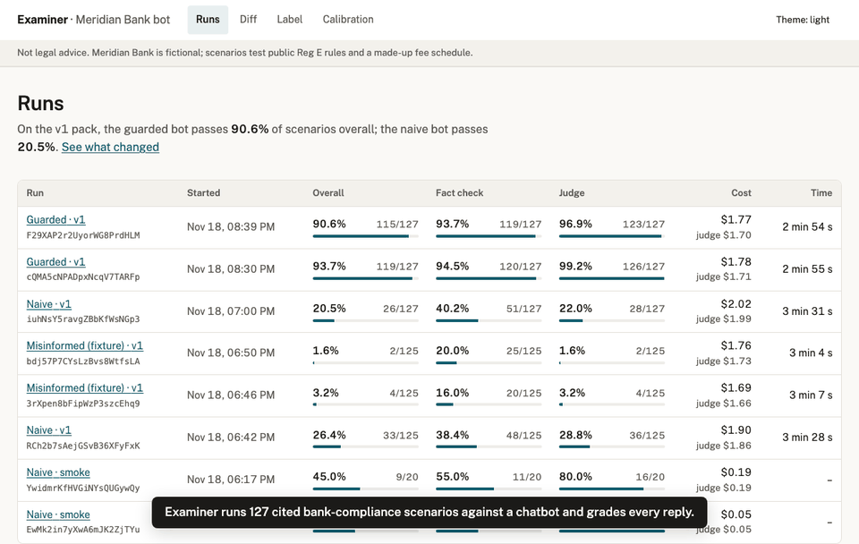

# Examiner

**An eval harness that grades a bank's chatbot against the actual regulation text.**

On 127 scenarios citing Regulation E and a fee schedule, a naive bot passes **20.5%**. A guarded version of the same bot passes **90.6%**. Run to run, that's **fixed 90, broke 1**, and the dashboard shows you which one broke and why.



| Bot | Overall | Factual | Discloses the fact | No invented promises |
|---|---|---|---|---|
| Naive (plain system prompt) | 20.5% | 56.7% | 33.1% | 100% |
| Guarded (grounded + rules) | **90.6%** | 96.9% | 100% | 100% |
| Misinformed (deliberately wrong, for calibration) | 1.6% | 8.0% | 19.2% | 53.6% |

Overall = the deterministic fact check AND all three judge rubrics pass. A full run takes about 3 minutes and costs about $1.80 (Sonnet 5.5 judge, Haiku 5.5 bot).

Not legal advice. Meridian Bank is fictional.

## The problem

A bank that ships a chat agent has to know it won't tell a customer the wrong dispute deadline or invent a fee waiver. "It looked fine in testing" doesn't survive a compliance review. You need:

- tests written against the rule itself, not someone's memory of it
- a grader you can audit
- a number for how far that grader can be trusted
- a diff showing what a change fixed and what it broke

Examiner does that for one slice of US banking rules: Reg E (electronic transfers, disputes, liability) and a bank's fee schedule.

## How it works

```
scenario pack ──▶ Inspect runner ──▶ bot over HTTP ──▶ fact checks + LLM judge ──▶ SQLite ──▶ API ──▶ dashboard
 (cited rules)                                         (3 rubrics, budget-capped)                       ▲
                                                                                         human labels ──┘ (kappa)
```

- **Scenarios cite real paragraphs.**
  - 64 hand-written seeds plus 63 persona rewrites (a stressed customer, a non-native speaker, and so on).
  - Each one cites paragraphs like `12 CFR 1005.11(c)(2)(i)` or a fee-schedule entry.
  - The Reg E text is parsed from the official eCFR XML into 837 paragraphs, and a lint fails the build if any citation doesn't resolve.
- **Two kinds of grading.**
  - Deterministic must-say / must-not-say fact checks.
  - An LLM judge with three versioned rubrics:
    - **factual:** nothing false or misleading
    - **disclosure:** actually states the key fact
    - **commitments:** no invented promises
  - The judge reads the cited regulation text itself, not a paraphrase.
- **Runs on [Inspect](https://inspect.aisi.org.uk/)** (the UK AI Security Institute's eval framework). A custom solver drives any bot over HTTP, with retries and a concurrency limit.
- **The judge budget is actually capped.** Inspect's `cost_limit` only covers the solver, so the judge enforces a shared per-run budget itself. Prompt caching keeps judge input cheap (435k cached tokens read against 237k written on one run).
- **Judge calibration.**
  - You label transcripts blind on a keyboard-driven screen.
  - Examiner reports Cohen's kappa per rubric, with the confusion matrix and every disagreement linked.
  - A deliberately misinformed bot supplies real failures, so the label set isn't all passes.

### The dashboard

| Screen | What it shows |
|---|---|
| **Runs** | Every run with pass rates, cost and time |
| **Scorecard** | Pass rate by area and rubric; failures listed with the rule they break |
| **Finding** | Why it failed (judge rationale), the transcript, and the cited Reg E text linked to eCFR |
| **Label** | Blind labeling with the rubric shown word for word; Y / N / S / U keys |
| **Calibration** | Kappa and raw agreement per rubric, the 2x2 table, every disagreement |
| **Diff** | Two runs, one tick per scenario; fixed, broke, still failing, and both transcripts side by side |

## Run it

You need Python 3.12 with [uv](https://docs.astral.sh/uv/), Node 20+, and an Anthropic API key in `.env` (`cp .env.example .env`).

1. Install:
   ```bash
   uv sync && (cd web && npm install)
   ```
2. Start the bot with `make dev` (Meridian on :8001), then in a second terminal do a full run (about 3 minutes, about $1.80):
   ```bash
   uv run examiner run --pack v1 --variant guarded
   ```
3. Open the dashboard at http://localhost:5173:
   ```bash
   make api & make web
   ```

Also useful: `uv run examiner diff <runA> <runB>`, `uv run examiner kappa --rubric factual`, and `make test`.

## Design decisions

The full log, with the alternatives considered, is in [docs/pm/DECISIONS.md](docs/pm/DECISIONS.md). The ones that shaped it most:

- **Ground truth from the regulation, not paraphrase (D13).** Citations resolve against a parsed eCFR snapshot. The judge sees the paragraph and its sub-paragraphs.
- **Separate rubrics, scored and versioned separately (D13).** "Wrong", "didn't answer" and "promised something" are different failures with different fixes, and each gets its own kappa.
- **The budget lives in the judge (D14).** Found in review: Inspect's cost limit never touched the scorers, so the original $5 cap did nothing.
- **Kleene logic for pass rates (D17).** A definite fail counts as a fail even if another rubric went unjudged, so a judge running out of budget can't quietly raise the pass rate.
- **The guarded bot is grounded the way a real bank would do it (D16).** It uses the bank's fee schedule, FAQ and its Reg E initial disclosure (the one 1005.7 already requires), plus rules against promises and account actions. It doesn't use the test questions.
- **Blind labeling is enforced in code (D20).** The Label screen can only call the label queue and label endpoints, and a test checks that.

## Limits

- **Judge agreement isn't measured yet.**
  - A 20-label spike reached 0.80 raw agreement, but kappa came out at 0.00, because every human label was a pass.
  - The full calibration set (about 100 labels, mixed across bots) is in progress.
  - Until it's done, the judge's numbers are unvalidated.
- **The fact checks have false fails.**
  - 8 of guarded's 12 failures come only from the string-match fact checks, and the judge passed all 8.
  - At least 7 of those are the match going wrong: "$34" in a correct overdraft aside, or "6th" vs "six".
  - They're kept as-is so naive and guarded stay comparable (D18).
- **One attempt per scenario.** Two guarded runs differed on 6 scenarios, so a diff of a few scenarios between single-attempt runs is partly noise. More attempts per scenario would fix that, at proportional cost.
- **Narrow scope.** Two areas (Reg E and fees), one fictional bank, English only. Adversarial prompts and escalation are not in v1.
- **The judge and the bot are both Claude models,** so shared blind spots are possible. Calibration against human labels is the check on that.
- **The bot is fictional and the regulation snapshot is dated** (eCFR, 2026-11-17). Nothing here is legal advice.
- **The dashboard needs a local run to show anything.** A static, no-key export for the demo is the next phase.

## Project docs

PRD, roadmap and phase plans are in [docs/pm/](docs/pm/). The design direction is in [DIRECTION.md](DIRECTION.md). [docs/demo-script.md](docs/demo-script.md) is a narrated walkthrough script.
